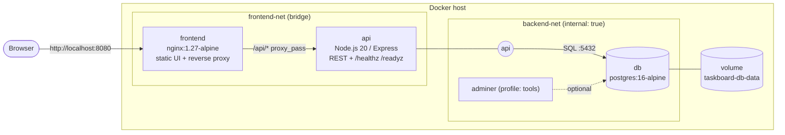
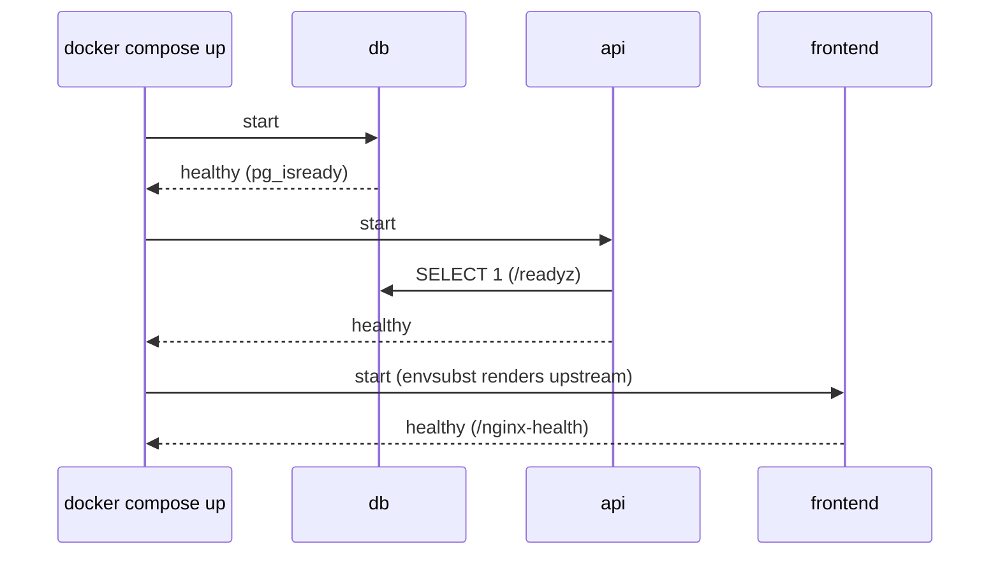

# Dockerized Web App: Taskboard

A production-style, multi-service web application containerised with Docker and orchestrated with Docker Compose. It runs an **Nginx frontend**, a **Node.js (Express) REST API** and a **PostgreSQL database**, each in its own container, connected through segmented networks, with healthchecks, a persistent volume and environment-driven configuration.


## Highlights

- **Three-tier architecture**: static frontend and reverse proxy, stateless API, stateful database.
- **Multi-stage Dockerfile** for the API: separate dependency, test and runtime stages, running as the non-root `node` user.
- **Healthchecks on every service**, with `depends_on: condition: service_healthy` so services start in the right order (DB, then API, then frontend).
- **Network segmentation**: the database sits on an `internal` network with no route out, and only the frontend publishes a port.
- **Persistent named volume** for Postgres data, plus a schema/seed script that runs on first start.
- **12-factor configuration**: everything comes from environment variables, with a documented `.env.example` and fail-fast checks for required values.
- **Hardening**: read-only root filesystems for the frontend and API, resource limits, security headers, no `X-Powered-By`, graceful shutdown on `SIGTERM`.
- **Compose profiles**: an optional Adminer DB UI that only starts when asked for.
- **Tests**: API unit tests (Node test runner) that also run inside the Docker build, plus an end-to-end smoke test script.

## Architecture



The `api` container is attached to both networks, so it is the only bridge between the public tier and the data tier. The `db` container is reachable only from inside `backend-net`.

### Startup order



## How it works

| Service | Image | Role | Port | Healthcheck |
|---|---|---|---|---|
| `frontend` | built from `frontend/` (nginx) | Serves the UI and proxies `/api/*` to the API | `${FRONTEND_PORT}` → 80 (published) | `GET /nginx-health` |
| `api` | built from `api/` (multi-stage) | Task CRUD API backed by Postgres | 3000 (internal only) | `GET /readyz` checks the DB connection |
| `db` | `postgres:16-alpine` | Stores tasks in a named volume | 5432 (internal only) | `pg_isready` |
| `adminer` | `adminer:4` (profile `tools`) | Optional DB admin UI | `${ADMINER_PORT}` → 8080 | none |

The nginx upstream address is not hard-coded. The official nginx image renders `templates/default.conf.template` with `envsubst` at startup, so `API_UPSTREAM` decides where requests go.

### API endpoints

| Method | Path | Description |
|---|---|---|
| GET | `/healthz` | Liveness: process is up |
| GET | `/readyz` | Readiness: database reachable (503 when it isn't) |
| GET | `/api/info` | App name, version and container hostname |
| GET | `/api/tasks` | List tasks |
| POST | `/api/tasks` | Create a task: `{"title": "..."}` |
| PATCH | `/api/tasks/:id` | Mark done or not done: `{"done": true}` |
| DELETE | `/api/tasks/:id` | Delete a task |

### Project layout

```
.
├── docker-compose.yml        # services, networks, volumes, healthchecks, profiles
├── .env.example              # every configurable variable, documented
├── Makefile                  # shortcuts: make up / test / smoke / down / clean
├── api/
│   ├── Dockerfile            # deps -> test -> runtime (non-root)
│   ├── package.json
│   ├── src/                  # app.js, server.js, config.js, repository.js, healthcheck.js
│   └── test/app.test.js      # unit tests with an in-memory repository
├── frontend/
│   ├── Dockerfile            # nginx + templated config
│   ├── templates/default.conf.template
│   └── public/               # index.html, app.js, styles.css
├── db/init/01-schema.sql     # schema + seed data (first start only)
└── scripts/smoke-test.sh     # end-to-end checks against the running stack
```

## Step-by-step: run it locally

### 1. Prerequisites

- Docker Engine 24+ (or Docker Desktop) with the Compose v2 plugin: `docker compose version`
- `make` and `curl` (optional, for the shortcuts and smoke test)
- Node.js 20+ (optional, only to run the unit tests outside Docker)

### 2. Clone and configure

```bash
git clone https://github.com/shubhamkhedkar/dockerized-web-app.git
cd dockerized-web-app
cp .env.example .env
```

Open `.env` and set at least `POSTGRES_PASSWORD`. Change `FRONTEND_PORT` if 8080 is already taken.

### 3. Validate the Compose file

```bash
docker compose config --quiet && echo "compose file is valid"
```

### 4. Build and start the stack

```bash
docker compose up -d --build      # or: make up
```

### 5. Check health

```bash
docker compose ps
```

All three services should show `(healthy)` within about 30 seconds. If one doesn't, check its logs with `docker compose logs api` (or `db`, `frontend`).

### 6. Use the app

Open <http://localhost:8080>. The badge at the top shows whether the API and database are up, and the footer shows which API container answered. You'll see three seeded tasks.

Or use the API through the proxy:

```bash
curl http://localhost:8080/api/tasks
curl -X POST -H 'content-type: application/json' -d '{"title":"Ship it"}' http://localhost:8080/api/tasks
curl -X PATCH -H 'content-type: application/json' -d '{"done":true}' http://localhost:8080/api/tasks/4
curl -X DELETE http://localhost:8080/api/tasks/4
```

### 7. Run the tests

```bash
make smoke          # end-to-end checks against the running stack
make test-image     # API unit tests inside Docker (build target "test")
make test           # API unit tests on your machine (Node.js 20+)
```

### 8. Optional: database UI

```bash
docker compose --profile tools up -d    # or: make tools
```

Open <http://localhost:8081>, choose **PostgreSQL**, server `db`, and the user, password and database from your `.env`.

## Things to try

- **Persistence**: add a task, run `docker compose down` then `docker compose up -d`. The task is still there because it lives in the `taskboard-db-data` volume.
- **Self-recovery**: `docker compose stop db`. The UI badge turns red and `/api/health` returns 503. Run `docker compose start db` and it recovers on its own.
- **Network isolation**: `docker compose exec api node -e "require('https').get('https://example.com', r => console.log(r.statusCode)).on('error', e => console.log('blocked:', e.code))"` still has outbound access through `frontend-net`, but the `db` container has none. Confirm with `docker network inspect taskboard_backend-net` (look for `"Internal": true`).
- **Scaling the API**: `docker compose up -d --scale api=3`, then refresh the page a few times and watch the hostname in the footer change as Docker DNS spreads requests across replicas.

## Configuration reference

| Variable | Default | Used by | Purpose |
|---|---|---|---|
| `COMPOSE_PROJECT_NAME` | `taskboard` | compose | Prefix for containers, networks and the volume |
| `FRONTEND_PORT` | `8080` | frontend | Host port for the app |
| `APP_NAME` | `Taskboard` | api | Name returned by `/api/info` |
| `APP_VERSION` | `1.0.0` | api, images | Image tag and reported version |
| `API_PORT` | `3000` | api, frontend | API listen port and nginx upstream port |
| `LOG_LEVEL` | `info` | api | Log verbosity |
| `DB_POOL_MAX` | `10` | api | Max Postgres connections per API container |
| `POSTGRES_DB` | required | api, db | Database name |
| `POSTGRES_USER` | required | api, db | Database user |
| `POSTGRES_PASSWORD` | required | api, db | Database password (example value only in `.env.example`) |
| `ADMINER_PORT` | `8081` | adminer | Host port for the optional DB UI |

Compose refuses to start if a required variable is missing, so a misconfigured stack fails immediately instead of half-starting.

## Cleanup

```bash
docker compose --profile tools down            # stop and remove containers + networks, keep data
docker compose --profile tools down -v         # also delete the Postgres volume (all tasks)
docker compose --profile tools down -v --rmi local   # also delete the locally built images
# or simply: make clean
```

Optionally reclaim build cache with `docker builder prune`.

## Troubleshooting

| Symptom | Fix |
|---|---|
| `port is already allocated` | Change `FRONTEND_PORT` (or `ADMINER_PORT`) in `.env` |
| `api` stays `unhealthy` | `docker compose logs api`; usually a wrong DB password in `.env` |
| Changed `POSTGRES_PASSWORD` but login fails | The DB was initialised with the old password. Run `docker compose down -v` to reset the volume (this deletes data) |
| Schema or seed changes don't apply | `db/init` only runs on a fresh volume; reset with `docker compose down -v` |

## License

MIT
